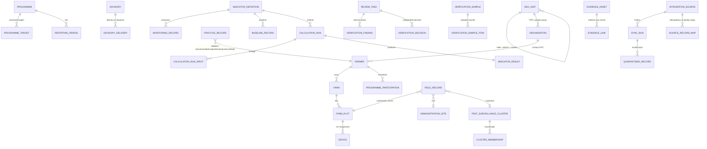

# Coffee Climate Resilience MRV Platform – architecture and operations

One integrated, FarmFuture-enabled MRV platform with seven functional workstreams and shared services
(Version 1 technical baseline + Version 2.0 programme scope). This repository is the API and data layer; the Angular
web client lives in the separate `mrv-frontend` repository.

## 1. Components

| Layer | Implementation |
|---|---|
| Web client | Angular 21 + Angular Material (repo `mrv-frontend`), role-filtered navigation, typed API client |
| API | FastAPI modular monolith, `/api/v1`, OpenAPI at `/docs`, consistent error envelope with `request_id` |
| Database | SQL Server via SQLAlchemy 2 + Alembic migrations (upgrade **and** downgrade tested on every test run) |
| Evidence storage | Private filesystem adapter (`STORAGE_DIR`), interface ready for an S3-compatible adapter |
| Integrations | Adapter registry + canonical payloads, field mappings, reviewed identity maps, quarantine/replay, sync runs |
| Background work | Daily scheduled pulls (`python -m app.services.integration.scheduler`, run every 15 min by Windows Task Scheduler / cron, or `SCHEDULER_ENABLED=true` in a single-process server); imports and reports otherwise run synchronously |

## 2. Seven workstreams (V2 §3)

| # | Module (`module_code`) | Record types / entities |
|---|---|---|
| 1 | Climate Intelligence & Early Warning (`climate`) | climate observation, climate risk assessment *(prediction)*, advisories/alerts, deliveries, responses |
| 2 | Soil & Water Management and Conservation (`water`) | water/soil-moisture measurement, irrigation event, water-balance output *(engine)*, conservation activity |
| 3 | Pest & Disease Risk Management (`pest`) | pest risk estimate *(prediction)*, inspection (linked to surveillance clusters), treatment/prevention practices |
| 4 | Soil & Microclimate Monitoring (`soil`) | soil test, sensor observation (device capability checked), device registry + calibration |
| 5 | Climate & Land Suitability / Plantation Planning (`suitability`) | suitability assessment, site finding, plantation condition, young-plantation survival |
| 6 | Farmer & Community Implementation (`farmer_fpo`) | training (attendance), demonstration visit, FPO capacity, CRPs, demonstration sites, inclusion attributes |
| 7 | MRV & Verification (`mrv`) | indicators, targets, baselines, monitoring, calculations, internal review, independent verification samples, reports |

Record types are declared once in `app/services/record_types.py` (fields, validation rules, data nature) and drive both the
API validation and the web forms. Every record carries its *data nature* – observed, user-reported, model prediction,
calculated, assessment – so predictions are never presented as confirmed conditions.

## 3. Data model (key entities)

57 tables in total (`app/models`). Conventions: UUID primary keys, no cascading deletes (SQL Server multiple-cascade
rule), archive flags instead of deletes, `is_demo` on synthetic data, actor and timestamp columns, separate lifecycle
status columns (submission / validation / review / verification), append-only `audit_events`.

## 4. MRV lifecycle

1. **Programme setup** – programme version, six states, clusters, FPOs/groups, demonstration sites, surveillance clusters,
   indicators (versioned), baselines and versioned targets (`proposed | approved | revised`).
2. **Collection** – manual forms and integration imports (`imported` submission status, source IDs, received time).
3. **Validation** – identity, plot/farmer match, units (explicit conversions only), timestamps, plausibility, duplicates,
   device capability/status → `valid | exception | rejected`; analysts resolve exceptions.
4. **Measurement** – versioned calculation methods; **blocked unless the indicator definition is approved**
   (`mrv.allow_provisional_calculations` allows clearly labelled PROVISIONAL results for testing/demo only).
   Inputs, parameters and method version are stored per run; older unreviewed results are superseded, not deleted.
5. **Internal review** – Internal Reviewer records findings, requests corrections, completes review.
6. **Independent verification** – Independent Verifier (≠ submitter, ≠ internal reviewer) records the decision; separately,
   verification *samples* (frame → seeded random/census/purposive draw → visit results → conclusion) mark practice
   adoption as verified/not verified.
7. **Reporting** – quarterly, annual, NABARD CCF-ID (official template pending), state/district, FPO, workstream,
   indicator, demonstration, surveillance, inclusion and verification reports; endline is blocked until its methodology is
   approved. Reports separate planned / enrolled / reached / participating / adopted (reported, observed) / verified.

## 5. Security and privacy

* Every endpoint enforces permissions server-side (`require(...)`), plus geography/organisation scope at record level.
* Roles (V2 §9): Super Admin, Programme Admin, State/District Coordinator, FPO/Grower Group Coordinator,
  Field Officer / CRP, MRV Analyst, Internal Reviewer, Independent Verifier, Farmer, Research/Partner read-only.
  Role permissions are editable (Admin → Roles).
* Personal data (phone, precise location) needs `farmer.read_pii`; sensitive beneficiary categories and demographic
  fields (configured as sensitive, e.g. tribal community) need `farmer.read_sensitive` to read or write; categories are
  assigned explicitly with a recorded basis and never inferred; reports contain aggregates only. PII/evidence reads are audited.
* Passwords: Argon2. Tokens: JWT (HS256, `SECRET_KEY`). Integration inbound keys are stored hashed and shown once.
* Evidence: type/extension/magic-byte checks, size limit, SHA-256 checksum, private storage, permission-checked download,
  GPS stored only with recorded consent.
* Secrets only in `.env` / environment (never committed). Use HTTPS and a secret manager in deployed environments.

## 6. Integrations (V2 §6)

| Source | Status in this build |
|---|---|
| FarmFuture Water Balance Engine (`farmfuture_water_engine`) | **Live, read-only (GET)** – irrigation plan / water account per linked farm; farm import |
| FarmFuture soil & microclimate (`farmfuture_soil_microclimate`) | **Live, read-only (GET)** – device import; daily SoilSync / MicroClime statistics; soil lab reports |
| FarmFuture pest & disease scouting (`farmfuture_pest_scouting`) | **Live, read-only (GET)** – app scouting → scouting / inspection records |
| FarmFuture satellite (`farmfuture_satellite`) | **Live, read-only (GET)** – per-block NDVI / NDMI |
| FarmFuture advisories (`farmfuture_advisories`) | **Live, read-only (GET)** – pest / disease / irrigation advisories (the FarmFuture API has no separate pest-prediction or climate-risk endpoint; its pest and disease warnings come from the advisory engine) |
| FarmFuture weather (`farmfuture_weather`) | **Live, read-only (GET)** – MicroClime station days and the 5-day forecast → climate observations / forecasts |
| Rainfall status (`platform_rainfall_status`) | **Platform calculation** – station rain vs 30-year normals per plot and month (`app/services/climate_status.py`); results go through the same pipeline as imports |
| FarmFuture Climate Intelligence Engine (`climate_intelligence`) | Placeholder adapter – the FarmFuture API has no climate-risk endpoint; refuses to run until one is supplied |
| FarmFuture Pest & Disease Prediction Engine (`pest_prediction`) | Placeholder adapter – superseded by `farmfuture_advisories` + `farmfuture_pest_scouting` unless a dedicated risk API is supplied |
| Mock water meter (`mock_water_meter`) | **MOCK** – synthetic paginated payloads with retry, duplicate and bad record |
| Mock IoT gateway (`mock_iot_gateway`) | **MOCK** – SoilSync/Moisture Probe/MicroClime/RainSync style readings |

Every pull – manual or scheduled – leaves a sync run; a pull that fails before any record is processed (expired token, source unreachable, missing configuration) is recorded as *failed* with its reason. `GET /api/v1/integrations/health` reports each source's freshness (ok / manual / stale / failed / never run) and the FarmFuture token expiry, shown on the dashboard and the Integrations page.

Inbound contract: `POST /api/v1/integrations/{source}/{measurements|observations|advisories}` with `X-Source-Key`.
Field mappings (incl. nested `attributes.x` targets and `payload_defaults`), reviewed identity maps for
farmer/plot/device IDs, exact-code matching configurable, quarantine with readable reasons, replay and discard.

## 7. Operations

**Configuration** – `.env` (see `.env.example`): `DATABASE_URL`, `TEST_DATABASE_URL`, `SECRET_KEY`, `CORS_ORIGINS`,
`STORAGE_DIR`, `MAX_UPLOAD_MB`, `APP_ENV` (`production` disables dev reset tokens and demo seeding).

**Deployment (outline)**
1. Provision SQL Server database and a login with DDL rights for migrations (runtime login can be DML-only).
2. `pip install -r requirements.txt`, set environment variables, `alembic upgrade head`.
3. `python -m app.seed reference`, then `MRV_ADMIN_PASSWORD=… python -m app.seed admin --email … --name …`.
4. Run `uvicorn app.main:app --host 0.0.0.0 --port 8010 --workers N` behind an HTTPS reverse proxy.
5. Build the frontend (`npm run build`), set `apiBaseUrl` in `environment.ts`, serve `dist/` from the proxy.
6. Health: `GET /api/v1/health` (liveness), `GET /api/v1/health/db` (readiness). Logs are structured JSON per request
   with `request_id` (also returned as `X-Request-ID`).

**Data consistency** – `python -m app.services.integrity [--programme CODE]` runs read-only checks (possible duplicate
farmers, farm/plot relationships, result lineage and recomputation, provisional labelling, verification audit trail and
independence). Exit code 1 when an error-level check fails; run it before generating NABARD reports.

**Backup and recovery**
* Database: SQL Server full backup daily + transaction-log backups (e.g. every 15 min) with point-in-time restore;
  test a restore to a scratch database monthly.
* Evidence files: back up `STORAGE_DIR` (or object-store versioning) on the same schedule; file checksums in
  `evidence_assets.checksum_sha256` allow integrity checks after restore.
* Restore order: database → evidence files → run `alembic current` to confirm schema version → health checks.
* Migrations roll back with `alembic downgrade -1` (downgrades are exercised by the test suite).

## 8. Configuration (no code change needed)

| What | Where |
|---|---|
| States/districts/clusters, provisional flags | Geography (`requires_confirmation`, `confirmation_note`) |
| Indicator definitions, formulas, evidence & verification rules, targets | Indicator catalogue (`configurable_formula` method, preview endpoint) |
| Beneficiary categories and demographic fields | Programme configuration → categories / demographic fields |
| Demonstration-site & cluster criteria, verification visit checklist | Programme configuration → criteria & checklists |
| Report layouts | Programme configuration → report templates (sections) |
| Policies (separation of duties, provisional mode, endline, matching) | Administration → System settings |
| Pending decisions | Programme status & decisions |

## 9. Known limitations (this release)

* FarmFuture connectors run on a 7-day test token (read-only GET); production credentials, IMD and other institutional data are not yet supplied.
* Indicator definitions are seeded as *Pending programme-owner approval*; demo results are PROVISIONAL.
* Official NABARD CCF-ID templates are not available; the CCF-ID report follows the platform structure.
* Endline/impact assessment is disabled until a methodology is approved.
* No offline field mode; the farm map uses open layers only (licensed high-resolution layers not available).
* Imports, calculations and reports run synchronously – add a job queue before very large imports.
* No antivirus scanning of uploads; email/SMS delivery for password reset is not configured.
* No sign-in lockout or throttling yet (failed sign-ins are audited) – policy decision `LOGIN_LOCKOUT` pending.
* Pending programme-owner decisions and their provisional treatment: see [FEATURE_STATUS.md](FEATURE_STATUS.md).
